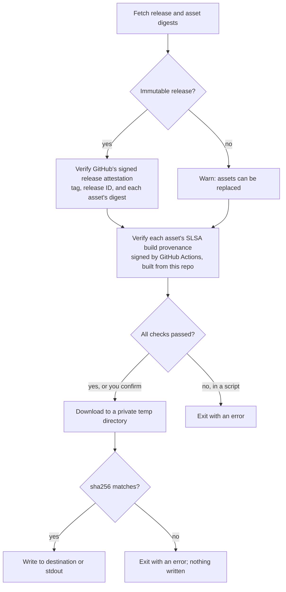

# gh verify-download

A [GitHub CLI](https://cli.github.com) extension that checks where a release asset came from **before** you download it.

```
gh extension install mrecachinas/gh-verify-download
```

## Why

Before running a binary from a GitHub release, it's worth knowing:

- Is the release **immutable**, so its assets can't be swapped out after publishing?
- Does the asset have **build provenance**, and if so, which workflow, commit, and branch built it?

`gh` can answer these with `gh release verify-asset` and `gh attestation verify`, but only after you've downloaded the file, and only one question at a time. `gh verify-download` answers both up front and then asks whether to continue.

## Usage

Pass a release asset URL (as copied from a release page), or a tag with `--repo` and `--pattern`:

```
gh verify-download https://github.com/OWNER/REPO/releases/download/v1.2.3/app.tar.gz
gh verify-download v1.2.3 -R OWNER/REPO -p '*.tar.gz'
```

It accepts the same flags as `gh release download`: `--dir`, `--output` (including `-O -` for standard output), `--clobber`, `--skip-existing`, and `--allow-escape-sequences`.

### Example: verified

```
$ gh verify-download https://github.com/cli/cli/releases/download/v2.102.1/gh_2.102.1_macOS_arm64.zip
cli/cli v2.102.1
✓ Immutable release, verified by GitHub's signed release attestation

gh_2.102.1_macOS_arm64.zip
✓ Listed in the signed release attestation
✓ Verified SLSA build provenance
  - Build instructions: https://github.com/cli/cli/blob/89d7dcec017194af1d6f8853176b2dae9c1da762/.github/workflows/deployment.yml
  - Source:             https://github.com/cli/cli/tree/89d7dcec017194af1d6f8853176b2dae9c1da762
  - Source ref:         refs/heads/bagtoad/go-1-27-3-patch-on-v2-102-0
  - Build run:          https://github.com/cli/cli/actions/runs/39482998765/attempts/1
  - Runner:             github-hosted
```

### Example: nothing to verify

```
$ gh verify-download https://github.com/vektra/mockery/releases/download/v2.53.8/mockery_2.53.8_Darwin_arm64.tar.gz
vektra/mockery v2.53.8
! Not an immutable release; assets can be replaced after publishing

mockery_2.53.8_Darwin_arm64.tar.gz
X No build provenance attestation found

? Download mockery_2.53.8_Darwin_arm64.tar.gz? (y/N)
```

In a terminal, you're asked whether to download, and the default is **No** if any check failed. In scripts, the command exits with an error instead.

## What it checks



- **Release attestation:** immutable releases get an attestation signed by GitHub when they're published. It has to verify, match this exact release (tag and release ID), and list each asset's name and digest.
- **Build provenance:** each asset's SLSA provenance attestation has to be signed by GitHub Actions and built from the release's repository. Any workflow may sign it, so reusable workflows in other repositories work, but the source repository is pinned. This is the same policy as `gh attestation verify --repo`.
- **The file itself:** assets are downloaded to a private temporary directory and hashed. They're only written to the destination if every asset matches, so a failed check never leaves a partial or tampered file behind.

Signatures are verified locally with [sigstore-go](https://github.com/sigstore/sigstore-go), using the same trusted roots as `gh` (Sigstore's public instance and GitHub's).

## Limitations

- **Source archives** (`zip`/`tar.gz` of the repository) aren't supported. GitHub generates them on demand, so there's nothing to attest.
- **GitHub Enterprise Server** isn't supported, because artifact attestations aren't available there. GitHub Enterprise Cloud with data residency (`*.ghe.com`) is.
- Most projects don't publish build provenance yet. If you maintain one, [`actions/attest`](https://github.com/actions/attest) adds it in a few lines, and GoReleaser [documents how](https://goreleaser.com/customization/publish/attestations/).

## Relationship to `gh release download --verify`

This extension has the same behavior as the proposed `--verify` flag in [cli/cli#14783](https://github.com/cli/cli/pull/14783), so it can be used and reviewed while that proposal is discussed.

## Verifying this extension

Releases are immutable, and binaries are built with [`cli/gh-extension-precompile`](https://github.com/cli/gh-extension-precompile) and have build provenance, so you can check them with the extension itself:

```
gh verify-download -R mrecachinas/gh-verify-download v0.1.1 -p '*darwin-arm64*'
```
